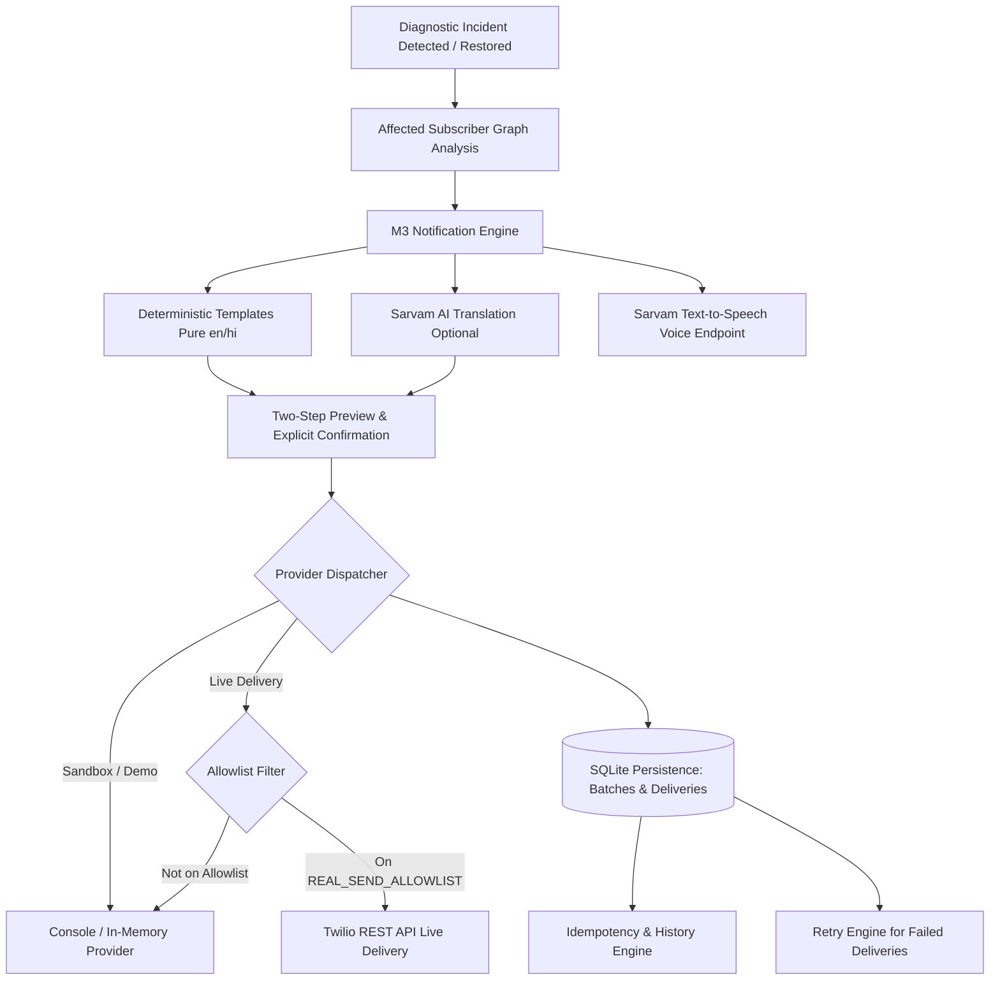

# HopTrace — Member 3 (M3: Notification) Architecture & Operations Manual

This document details the complete end-to-end implementation of the Member 3 (M3 — Notify) lane for HopTrace.

---

## 1. Overview & Architecture

HopTrace M3 provides a resilient, multi-channel (SMS & WhatsApp), multi-language outage notification and subscriber communication system designed for rural ISPs.



### Key Architectural Principles
1. **Separation of Concerns**: Network diagnostic logic (M1) determines root cause and affected subscribers via `DependencyAnalysisAdapter`; M3 handles personalized localization, delivery, persistence, and operator confirmation.
2. **Deterministic-by-Default Fallback**: Default previews and notifications run pure, deterministic local templates without depending on external LLMs or third-party networks.
3. **Safe Sandbox Routing & Allowlist**: Real carrier charges are strictly prevented unless phone numbers are explicitly present on `REAL_SEND_ALLOWLIST`. Unapproved numbers are transparently and safely routed to the in-memory sandbox.
4. **Guaranteed Idempotency**: Header `Idempotency-Key` is strictly recorded with `UNIQUE(incident_id, idempotency_key)` in SQLite, preventing double-click and duplicated batch sends.
5. **No Regressions & Pure HopTrace Branding**: Clean decoupling, 0 external runtime dependencies beyond stdlib in the backend, and strict HopTrace branding (no "GramNet").

---

## 2. API Endpoints Contract

All endpoints are hosted under `/api/v1` and registered via `backend/app/api/notify.py`:

| Method | Endpoint | Description |
|---|---|---|
| `GET` | `/api/v1/incidents/{id}/notifications/preview` | Preview localized messages (`channel=sms\|whatsapp`, `kind=outage\|restored`, `translate=false\|true`). |
| `POST` | `/api/v1/incidents/{id}/notify` | Dispatches notification batch. Requires `Idempotency-Key` header. Prevents duplicates. |
| `GET` | `/api/v1/notifications/status` | Current provider status, allowlist count, Twilio & Sarvam readiness. |
| `GET` | `/api/v1/incidents/{id}/notifications` | Historical dispatch batches and individual delivery statuses. |
| `POST` | `/api/v1/incidents/{id}/notifications/retry` | Retries only eligible failed deliveries within a batch. |
| `POST` | `/api/v1/voice` | Sarvam AI text-to-speech voice synthesis. Returns base64 audio. |

---

## 3. Database Schema

Initialized via `backend/app/db/notify_schema.py` (`ensure_notify_tables`):

### `notification_batches`
- `id TEXT PRIMARY KEY`: Unique batch identifier (`batch-{uuid}`).
- `incident_id TEXT NOT NULL`: Associated diagnostic incident.
- `kind TEXT NOT NULL`: `outage`, `restored`, or `village_status`.
- `channel TEXT NOT NULL`: `sms` or `whatsapp`.
- `provider TEXT NOT NULL`: `console` or `twilio`.
- `idempotency_key TEXT NOT NULL`: Client idempotency key.
- `created_by TEXT`: Operator username/role.
- `created_at TEXT NOT NULL`: UTC ISO timestamp.
- **Constraint**: `UNIQUE (incident_id, idempotency_key)`.

### `notification_deliveries`
- `id TEXT PRIMARY KEY`: Unique delivery identifier (`deliv-{uuid}`).
- `batch_id TEXT NOT NULL REFERENCES notification_batches(id)`: Foreign key.
- `subscriber_id TEXT NOT NULL`: Target subscriber ID (`SUB101`, etc.).
- `language TEXT NOT NULL`: Language code (`hi`, `en`, etc.).
- `message TEXT NOT NULL`: Full rendered message delivered.
- `message_source TEXT NOT NULL`: `template` or `sarvam`.
- `status TEXT NOT NULL`: `queued`, `sent`, `delivered`, `failed`.
- `message_id TEXT`: External carrier SID or internal ID.
- `error TEXT`: Specific error detail if failed.
- `updated_at TEXT NOT NULL`: UTC timestamp of latest attempt.

---

## 4. Frontend Notification UI

Built under `frontend/src/components/Notify/` and integrated into the primary incident panel:

- **Incident Context**: Displays suspected component, village, and affected subscriber count.
- **Channel Selector**: Single-click toggle between SMS and WhatsApp.
- **Kind Selection**: Switch between Outage Alert and Restoration Notice.
- **Sarvam AI Toggle**: Toggle between deterministic template (zero external dependency) and Sarvam AI translation with automatic template fallback.
- **Subscriber Preview List**: Checkbox selection, "Select All Eligible", "Deselect All", masked phone numbers (`+91 98••••10`), language badge, and message preview.
- **Voice Player**: Listen to synthesized Indian voice audio (Meera persona) for previewed messages.
- **Send Confirmation Dialog**: Two-step flow displaying exact recipient count, delivery channel, sandbox vs live provider indicator, and irreversible dispatch warning.
- **Delivery Status & Retries**: Live summary of sent vs failed deliveries, with a "Retry Failed" button that resends *only* failed items.
- **Role-Based Access Control**: Viewers can preview messages and inspect history, but send and retry buttons are disabled with clear explanatory tooltips.

---

## 5. Configuration & Environment Variables

Configure in `.env`:

```env
# Outage Notification Provider: "console" (sandbox), "twilio", or "unavailable" (503)
NOTIFICATION_PROVIDER=console

# Real-Send Allowlist: Comma-separated E.164 phone numbers permitted for live delivery
REAL_SEND_ALLOWLIST=+919876543210,+919876543211

# Twilio Credentials (only required when NOTIFICATION_PROVIDER=twilio)
TWILIO_ACCOUNT_SID=
TWILIO_AUTH_TOKEN=
TWILIO_FROM_NUMBER=
TWILIO_WHATSAPP_FROM_NUMBER=

# Sarvam AI Credentials (for translation and voice synthesis)
SARVAM_API_KEY=
SARVAM_MODEL=sarvam-105b
SARVAM_TIMEOUT_SECONDS=15
```

---

## 6. Verification and Testing

### Backend Unit & Integration Tests (45 Test Cases)
Run:
```bash
PYTHONPATH=".:backend" backend/.venv/bin/python -m pytest tests/api/test_notify.py -v
```
All 45 test cases pass:
- Template rendering (English, Hindi, unknown fallback, missing context).
- Preview generation & subscriber filtering.
- Translation integration & fallback chain.
- SQLite schema idempotency & persistence.
- Provider dispatch, allowlist routing, and Twilio error isolation.
- DB-level idempotency & deduplication.
- Retries of failed deliveries without resending successful deliveries.
- Full API error handling (400, 404, 503).

Full suite check (285 passing tests):
```bash
PYTHONPATH=".:backend" backend/.venv/bin/python -m pytest tests/ -q
```

### Frontend Tests & Quality Checks
Run unit tests:
```bash
cd frontend && npm test
```
Result: 67 passed in 134ms.

Run linting:
```bash
cd frontend && npm run lint
```
Result: Clean (0 errors, 0 warnings).

Run production build:
```bash
cd frontend && npm run build
```
Result: Built successfully in ~470ms.
